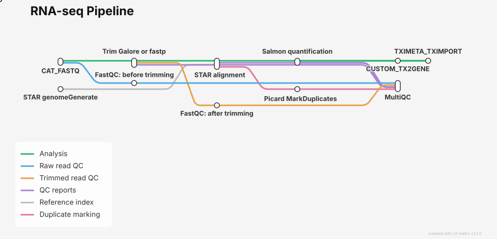

# computational-workflows/rnaseq

A short-read bulk RNA-seq pipeline made by **Wanchen Zhang and Kritika Manna** for the Computational Workflows course. We used the nf-core template and modules. This is a course project, not an official nf-core pipeline.

[Project report (PDF)](https://github.com/wanchenzhang/rnaseq/releases/download/v1.0.0/RNA_seq_workflow.pdf) | [Tool references](CITATIONS.md)

## What it does

The pipeline supports single-end reads, paired-end reads and several sequencing runs from the same sample.

1. Check the samplesheet and merge runs from each sample with CAT_FASTQ.
2. Run FastQC before trimming.
3. Trim reads with Trim Galore (default) or fastp.
4. Run FastQC on the trimmed reads.
5. Build a STAR index and align the reads. STAR also sorts the genome BAM.
6. Mark duplicates with Picard. Reads are marked, not removed.
7. Use Salmon to measure transcript expression from STAR's transcriptome BAM.
8. Use CUSTOM_TX2GENE and TXIMETA_TXIMPORT to make a gene-by-sample TPM table.
9. Collect QC results in MultiQC.

Picard and Salmon use different BAM files from STAR. Salmon does not use the Picard output. If no transcript FASTA is given, GFFREAD makes one from the genome FASTA and GTF.



## Run the test

You need Nextflow **>=25.10.4**, a compatible Java installation, Git and Docker. Use Linux or Windows with WSL2. Docker must work in the terminal where you run Nextflow. An internet connection is needed to download test files and containers.

```bash
git clone https://github.com/wanchenzhang/rnaseq.git
cd rnaseq
nextflow run . -profile test,docker --outdir results_test
```

The `test` profile supplies a public samplesheet, reads and reference files from [nf-core/test-datasets](https://github.com/nf-core/test-datasets/tree/rnaseq). You do not need to prepare local data first. The test has seven runs grouped into five yeast samples, with both single-end and paired-end reads. It supplies a transcript FASTA, so GFFREAD is skipped.

Each task is limited to **4 CPUs, 4 GB RAM and one hour**. Several tasks can run at the same time, so the whole run can use more than 4 GB. Docker is the only container profile we tested. `test_full` uses the same small dataset as `test`; it is not a full-size test.

## Run your own data

Create a CSV samplesheet:

```csv
sample,fastq_1,fastq_2
SAMPLE_A,/absolute/path/SAMPLE_A_1.fastq.gz,/absolute/path/SAMPLE_A_2.fastq.gz
SAMPLE_B,/absolute/path/SAMPLE_B.fastq.gz,
```

- Leave `fastq_2` empty for single-end reads.
- Repeat a sample name for multiple runs of the same sample. The pipeline merges them before trimming.
- Use different names for different biological samples. Do not mix single-end and paired-end runs under one name.
- Sample names cannot contain spaces. Use `.fastq.gz` or `.fq.gz` files.

Provide an uncompressed genome FASTA and GTF from the same species and genome assembly:

```bash
nextflow run . \
    -profile docker \
    --input samplesheet.csv \
    --fasta /absolute/path/genome.fa \
    --gtf /absolute/path/genes.gtf \
    --outdir results
```

You can add `--transcript_fasta /absolute/path/transcripts.fasta` to skip GFFREAD. The transcript IDs and sequences must match the GTF and STAR reference.

Before using another organism or read length, review `conf/modules.config`. STAR currently uses `--genomeSAindexNbases 10` and `--sjdbOverhang 149`. The test reads are about 101 bp, so an overhang of 100 would fit that length; the current setting came from earlier development. Also check CPU, memory and sorting limits for larger data. The current non-test STAR request is 8 CPUs and 20 GB RAM.

## Choose the trimmer

Trim Galore is the default. To use fastp:

```bash
nextflow run . -profile test,docker --trimmer fastp --outdir results_test_fastp
```

To use fastp with polyX trimming and paired-end overlap correction:

```bash
nextflow run . -profile test,docker,fastp_optional --outdir results_test_fastp_optional
```

For your own data, use `-profile docker,fastp_optional` with your samplesheet and references.

| Setting             | Default | Meaning                                            |
| ------------------- | ------- | -------------------------------------------------- |
| `fastp_trim_poly_x` | `false` | Trim repeated bases at read ends, such as polyA    |
| `fastp_poly_g`      | `auto`  | Use `auto`, `on` or `off` for polyG trimming       |
| `fastp_correction`  | `false` | Correct some errors where paired-end reads overlap |

For example, add `--fastp_poly_g on` to force polyG trimming. Set Boolean options in a configuration profile using `true` or `false` without quotes. Bare Boolean command-line flags failed type checks in our environment; the tested `fastp_optional` profile avoids this problem.

Both trimmers feed the same FastQC, STAR and Salmon steps. Fastp's own HTML report is extra; it does not replace FastQC. UMI-aware counting, paired-read merging, long-read analysis and single-cell analysis are not included.

## Main outputs

All paths below are inside `--outdir`.

| Folder                        | Files                                                              |
| ----------------------------- | ------------------------------------------------------------------ |
| `cat/`                        | Reads merged by sample                                             |
| `fastqc/` and `fastqc_after/` | FastQC reports before and after trimming                           |
| `trimgalore/` or `fastp/`     | Trimmed reads and trimming reports                                 |
| `reference/`                  | STAR index and transcripts made by GFFREAD, if needed              |
| `star/`                       | Sorted genome BAMs, transcriptome BAMs and STAR logs               |
| `markduplicates/`             | Marked BAMs, indexes and duplicate metrics                         |
| `salmon/<sample>/`            | Expression estimates for each sample                               |
| `tximport/`                   | Gene and transcript tables                                         |
| `multiqc/`                    | `multiqc_report.html` and report data                              |
| `pipeline_info/`              | Parameters, software versions, reports, traces, timelines and DAGs |

The main expression table is `tximport/salmon_merged.gene_tpm.tsv`. It has `gene_id`, `gene_name` and one column per sample. TPM is relative expression; this pipeline does not test differential expression. See [output details](docs/output.md).

## Check the results

Both trimming branches completed the five-sample test during the project. The output checker returned `PASS=43 WARN=0 FAIL=0` for each run.

```bash
python bin/validate_outputs.py \
    --samplesheet https://raw.githubusercontent.com/nf-core/test-datasets/rnaseq/samplesheet/v3.10/samplesheet_test.csv \
    --outdir results_test \
    --trimmer trimgalore
```

For fastp, use its output folder and `--trimmer fastp`. The checker saves `validation_report.tsv`. It checks FASTQ records, paired-read IDs and counts, TPM values, and whether key files exist and are nonempty. It does not check BAM contents or compare merged counts with all original reads.

Also read FastQC and MultiQC. A completed run does not mean every QC check passed. Small counts can appear as `0.0 M` because MultiQC rounds values in millions. Check the STAR logs for exact counts.

GitHub lint checks cover code checks and formatting. They do not replace a full pipeline run. The test files follow a public branch that can change, and the small reference is for testing rather than biological conclusions.

## Continue a run or record time

Keep `work/` and the Nextflow cache to use `-resume`:

```bash
nextflow run . -profile test,docker --outdir results_test -resume
```

For a fresh timing run, omit `-resume`:

```bash
/usr/bin/time -p -o runtime_test.txt \
    nextflow run . -profile test,docker --outdir results_test_timed
```

Downloads can affect total time. Use the matching files in `pipeline_info/` for task times. If a run fails, start with `.nextflow.log` and the task's `.command.err`. On WSL, check available memory and Docker access.

## Project files

- `main.nf`: entry point.
- `workflows/rnaseq.nf`: connects the analysis modules.
- `nextflow.config`: parameters and profiles.
- `conf/modules.config`: tool options, resources and output paths.
- `conf/test.config`: test inputs and limits.
- `nextflow_schema.json` and `assets/schema_input.json`: parameter and samplesheet rules.
- `bin/validate_outputs.py`: output checks.

More information: [usage](docs/usage.md), [outputs](docs/output.md), [development notes](docs/CONTRIBUTING.md) and the earlier [trimming benchmark](benchmark.md). The earlier benchmark used a different dataset setup from the five-sample test.

## Credits and license

Developed by **Wanchen Zhang and Kritika Manna**. Both authors contributed; all commits were made from one shared device.

We used the nf-core template, modules and test data, and thank the developers of the tools listed in [CITATIONS.md](CITATIONS.md). The project uses the [MIT License](LICENSE).
